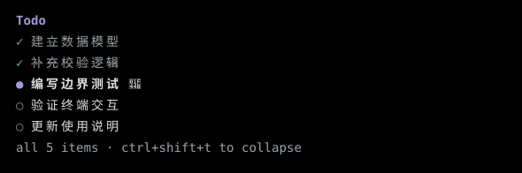

# pi-kimi-style-todo

一个独立的 Pi TODO 扩展：保留 [rpiv-todo 2.15.0](https://github.com/juicesharp/rpiv-mono/tree/ce6d3530410812ca504ec294995581a52170f9e1/packages/rpiv-todo) 的任务内核和会话恢复能力，提供 Kimi-inspired 的简洁列表。

**0.1.0** · MIT · [npm](https://www.npmjs.com/package/pi-kimi-style-todo)



预览由真实 Pi PTY 中的合成任务单元格重建，不使用用户的私有参考截图。强调色来自当前 Pi 主题，不固定为蓝色。

## 功能

- 编辑器上方的无边框、无树形连接线列表；不替换编辑器、页眉或底栏，不获取输入焦点。
- `✓`：绿色勾、弱化正文和删除线；`●`：主题强调色圆点、高对比度粗体正文；`○`：待开始。
- 默认保留已完成任务；折叠和超出行数只影响显示，不修改任务或依赖。
- 有限行数优先展示进行中、待开始、完成项，选中后仍保持原始顺序。底部准确显示全部／部分数量。
- `Ctrl+Shift+T` 折叠／展开；`Ctrl+T` 留给 Pi 的 thinking toggle。
- `/todos` 打开可滚动的详情列表，显示 description、activeForm、owner、metadata 与依赖。方向键／PageUp／PageDown／Home／End 滚动，Esc 返回编辑器。
- `todo` 六种动作、`tasks[]` 原子批量创建、完整 snapshot、旧会话读取、nested/codemode 持久化、branch 和 session 隔离继续保留；兼容二次 JSON 编码的批量参数，恢复时跳过损坏快照。
- print／JSON 下工具正常运行；RPC 的 `/todos` 使用通知，不绘制终端组件。

## 安装与使用

要求 Node **22.19+** 和 Pi。当前验证基线为 Linux、Node **24.18.0**、npm **11.8.0**、Pi **1.4.0**。

先禁用原 `rpiv-todo`（以及任何也注册 `todo` 的扩展），再加载本扩展。不要同时启用新旧包。

### 从 npm 安装

```sh
pi install npm:pi-kimi-style-todo@0.1.0
```

安装后重新启动 Pi，或在当前会话执行 `/reload`。

### 从本地源码加载

```sh
cd /path/to/pi-kimi-style-todo
npm ci --ignore-scripts

# 本次运行使用，不写入 Pi 的包设置
pi --extension ./index.ts
```

需要持久启用本地目录时，由你执行：

```sh
pi install /absolute/path/to/pi-kimi-style-todo
```

Pi 直接加载 TypeScript，不需要编译步骤。扩展自身不访问 Kimi API，不登录、不请求额外模型，也不自动迁移其他扩展的配置。

### 安装本地 tarball

```sh
npm pack --ignore-scripts
# 在单独目录安装，不自动安装第二份 Pi 宿主 peer
mkdir -p /path/to/local-todo
npm install --prefix /path/to/local-todo --ignore-scripts --omit=dev --legacy-peer-deps \
  /path/to/pi-kimi-style-todo/pi-kimi-style-todo-0.1.0.tgz
pi --extension /path/to/local-todo/node_modules/pi-kimi-style-todo
```

安装包依赖公开的 `@juicesharp/rpiv-config@2.13.8`；Pi 提供宿主包。构建、测试和运行都不需要私有规划仓库。

## 配置

创建 `$XDG_CONFIG_HOME/pi-kimi-style-todo/config.json`；未设置有效 XDG 路径时使用 `~/.config/pi-kimi-style-todo/config.json`：

```json
{
  "maxWidgetLines": 12,
  "collapseKey": "ctrl+shift+t",
  "completedDisplay": "retain"
}
```

- `maxWidgetLines` 包含标题和底部；过矮终端会进一步减少可见行，不挤掉输入区域。`Ctrl+O` 不会无限扩展 widget。
- `collapseKey` 可改为 `alt+o` 等按键，或 `off`。改键后需 `/reload`；重载前仍提示实际旧绑定。
- 与宿主有效按键冲突时不注册，显示诊断；不会改写 Pi 的 keybindings 文件。
- `completedDisplay: "hide-previous-turn"` 只隐藏上一轮真正展示过的完成项，同时报告隐藏数量。任务仍可在 `/todos` 或 `todo list` 查看。
- 可选 `guidance` 延续上游 promptSnippet／promptGuidelines 覆盖语义。

完整路径规则、错误回退和配置示例见 [配置说明](docs/configuration.md)。

## 从 rpiv-todo 替换

1. 在 Pi 的包配置中禁用／移除原 TODO 扩展，确认不再注册它的 `todo`。
2. 启用本扩展并 `/reload` 或重新启动 Pi。
3. 旧会话的 `todo` tool-result details 和 `rpiv-todo-state` custom entries 会继续读取；不需要复制会话文件。
4. 如需沿用个人选项，手动挑选配置字段写入新目录。不会读取或写入 `rpiv-todo/config.json`。

工具参数、状态迁移和错误 envelope 见 [工具协议](docs/tool-schema.md)。不要为了改包名改动历史持久化标识。

## 验证与开发

```sh
npm ci --ignore-scripts
npm run verify     # runtime 类型检查、单元/SDK、资源/CLI、打包安装
npm run test:tui   # 真实 Pi PTY：regular/fullscreen、resize、主题、输入、resume、组合 probes
```

测试使用临时 HOME／XDG／agent／workspace、合成会话和本地 faux provider，拦截网络。PTY 检查屏幕单元格、ANSI 粗体／删除线／颜色和实际按键，不只搜索输出字符串。`test:tui` 在 Linux 需要 Python 3；不使用用户登录或历史会话。详见 [测试说明](docs/testing.md)。

## 兼容范围与限制

- 实测：Linux 上 Pi **1.4.0** 的 regular／fullscreen，以及 text／JSON／RPC。
- 中文、组合字符、emoji 的列宽已有测试；具体字体、删除线和 IME 候选窗口仍取决于终端。未声称验证了 macOS、Windows 或真实操作系统 IME。
- `Ctrl+Shift+T` 需要终端区分修饰键（Kitty／modifyOtherKeys 等）；若被终端截获或无法区分，配置其他空闲按键。极小终端可能只显示数量摘要或暂不绘制 widget。
- 编辑器／HUD／工具渲染组合通过独立合成 probes 验证，不代表所有第三方扩展组合均已验证。
- `@juicesharp/rpiv-i18n` 为可选 peer；有包时使用已注册语言，缺失时安全回退到英文。新 widget 文案提供中英文本，其他语言可回退英文。

## 来源与许可

任务内核固定为 `@juicesharp/rpiv-todo@2.15.0`，提交 `ce6d3530410812ca504ec294995581a52170f9e1`；初始界面及其余保留导入来自 2.13.8。逐文件来源、提交和原始哈希见 [UPSTREAM.json](UPSTREAM.json)，衍生范围见 [第三方声明](THIRD_PARTY_NOTICES.md)。内核不在运行时自动更新；上游同步方式及边界见[内核维护说明](docs/upstream-sync.md)。

原创贡献采用 [MIT](LICENSE)；完整上游声明保留在 [licenses/rpiv-todo-MIT.txt](licenses/rpiv-todo-MIT.txt)。

这是独立社区项目，与 Kimi／Moonshot AI、Pi 或 rpiv-todo 作者无官方隶属或背书关系，不复用品牌素材。
